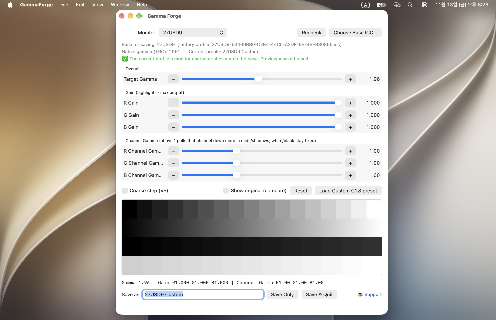

# Gamma Forge (display-gamma-forge)

[English](README.md)

macOS용 디스플레이 감마/톤 커브 조절기입니다. 측색기 없이 눈으로 보면서 미세 조정하고, 결과를 **ICC 프로파일**로 출력합니다.

상시 적용 앱이 아니고 색상 프로파일을 생성해주는 도구입니다. 저장 후 앱을 끄면 화면은 원래 설정으로 돌아가고, 시스템 설정 › 디스플레이 › 색상 프로필에서 새로 만든 프로파일을 선택해야 결과가 적용됩니다.

macOS 12(Monterey) 이상, x86_64/arm64 모두 지원합니다.



## 설치

x86_64/arm64 유니버설 바이너리를 [Releases](https://github.com/wooooooooook/display-gamma-forge/releases)에 올려 두었습니다. [install.sh](install.sh)가 최신 버전을 받고 checksum을 검사하도록 했습니다.

```sh
curl -fsSL https://raw.githubusercontent.com/wooooooooook/display-gamma-forge/main/install.sh | sh
```

> 서명/notarize 되어 있지 않으니, `install.sh`가 하는 체크섬 검증 후 실행을 권장합니다.

## 왜 필요한가

macOS가 EDID로 자동 생성하는 공장 프로파일은 모니터마다 감마·화이트포인트가 조금씩 다르지만, macOS에서 ICC 조절 기능을 제공하지 않습니다. Gamma Forge는 공장 프로파일을 기준으로 잡고 감마·화이트 밸런스·채널별 중간톤만 수정해서 새 ICC 프로파일을 만들어 줍니다. Gamma Forge는 모니터 자체에 색상 조절 기능이 없거나 부족할 때 소프트웨어로 보완하는 용도입니다.

일반적으로 모니터를 최대 밝기 또는 주로 사용하는 밝기로 고정시킨 후 Gamma Forge 사용을 권장합니다.

## 원리

- 미리보기: `CGSetDisplayTransferByTable`로 디스플레이 감마 테이블(vcgt가 로드되는 자리)을 실시간으로 덮어씌웁니다. 앱이 종료되면 macOS가 원래 설정으로 자동 복원합니다.
- 커브: 채널 c(R/G/B)마다 다음 공식을 256포인트 16-bit 테이블로 계산합니다.

  ```
  out(x) = gain_c * x ^ ( (모니터 고유 감마 / 목표 감마) * 채널 감마_c )
  ```

  - 목표 감마: 낮출수록 중간톤이 진해집니다(대비 ↑).
  - 게인: 채널의 최대 출력입니다. 흰색의 색감(색온도/틴트)을 정합니다.
  - 채널 감마: 흰색·검정은 그대로 두고 중간·어두운 톤만 바꿉니다. 블랙 레벨(오프셋)과는 다른 개념입니다.
- 저장: 기준이 되는 공장 프로파일에서 원색·화이트포인트·TRC·chad는 그대로 두고, 기존 vcgt를 제거한 뒤 새 vcgt(type 0 table, 3채널 × 256 × 16bit)와 새 이름(desc)만 추가해 `~/Library/ColorSync/Profiles/`에 저장합니다. 공장 프로파일 자체는 건드리지 않습니다.
- 기준 불일치 경고: 색 관리 앱의 미리보기는 *현재 시스템 설정에서 선택된 프로파일*을 거치므로, 그 프로파일의 원색·화이트·TRC가 저장 기준과 다르면 미리보기와 저장 결과가 어긋날 수 있습니다. 앱이 이를 감지해 경고를 띄웁니다.

## 소스에서 빌드

Xcode Command Line Tools가 필요합니다.

```sh
xcode-select --install
swiftc -parse-as-library -O GammaForge.swift -o GammaForge
./GammaForge
```

## 사용법

1. 상단에서 조절할 모니터를 고릅니다. "저장 기준"에 어떤 프로파일(보통 공장 프로파일)을 기준으로 저장할지 표시됩니다.
2. 목표 감마 / 게인(R·G·B) / 채널 감마(R·G·B) 슬라이더를 조절하면서 화면과 아래 테스트 패턴(계단·그라데이션)으로 바로 확인합니다.
3. "원본 보기"로 보정 전과 비교하거나, "초기화"로 되돌릴 수 있습니다.
4. 결과가 만족스러우면 이름을 정하고 "저장만" 또는 "저장하고 종료"를 누릅니다. 파일은 `~/Library/ColorSync/Profiles/<이름>.icc`로 저장됩니다.
5. 시스템 설정 › 디스플레이 › 색상 프로필에서 방금 만든 프로파일을 선택합니다.
6. 같은 이름으로 덮어썼다면, 시스템이 캐시된 이전 버전을 쓰지 않도록 다른 프로파일을 한 번 선택했다가 다시 선택해 주세요.

## 주의사항

- 모니터를 최대 밝기 또는 주로 사용하는 밝기로 고정시킨 후 Gamma Forge 사용을 권장합니다. 모니터는 밝기에 따라 화이트포인트가 조금씩 이동합니다(최대 밝기에서 녹색 쪽, 낮은 밝기에서 붉은 쪽으로). 고정된 vcgt로는 이걸 보정할 수 없으니, 평소 쓰는 밝기에서 조절하시는 게 좋습니다.
- Night Shift / True Tone을 꺼 두고 조절하세요. 둘 다 실시간으로 화면 색을 바꾸기 때문에 커브를 왜곡시킵니다.
- 디스플레이 설정의 "밝기 자동 조절"을 꺼 두세요. macOS Tahoe 이후 이 옵션이 켜져 있으면 `CGSetDisplayTransferByTable` 호출이 무시된다는 보고가 있습니다.
- BetterDisplay, MonitorControl 등 감마 테이블을 조작하는 다른 앱과 동시에 쓰지 마세요. 모니터 또는 Macbook 디스플레이의 밝기 조절이 비 정상적으로 동작한다는 보고가 있습니다.
- 정확한 캘리브레이션 도구가 아닙니다.

## 알려진 이슈

- 새 프로파일을 시스템 설정에서 처음 선택한 직후, 노트북 덮개를 여닫으면 vcgt가 풀리는 현상이 보고된 적이 있으나, macOS를 재부팅하면 해결 가능합니다.

## 라이선스

MIT License

## 제작자

[](https://github.com/wooooooooook/display-gamma-forge/graphs/contributors)

## 후원

[](https://buymeacoffee.com/wooooooooook)
